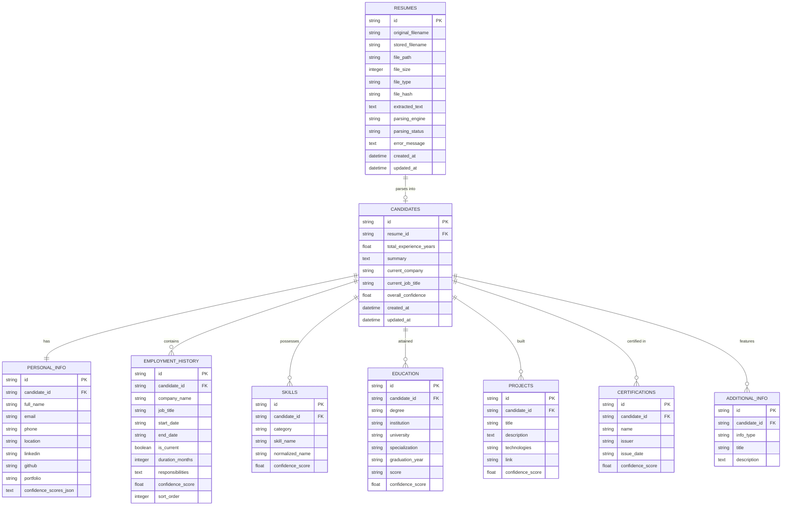

# Database Design Specification (DATABASE_DESIGN.md)

## System: AI-Powered Resume Parser (Standalone Application)
**Database Engine:** SQLite 3  
**Database File:** `backend/storage/resume_parser.db`  
**ORM:** SQLAlchemy 2.0  

---

## 1. Entity-Relationship Diagram

---

## 2. Table Schemas & Data Dictionaries

### 2.1 `resumes`
Stores the raw file artifacts and raw extracted text streams.
| Column | Type | Constraints | Description |
|:---|:---|:---|:---|
| `id` | VARCHAR(36) | PRIMARY KEY | UUID v4 |
| `original_filename` | VARCHAR(255) | NOT NULL | User's uploaded filename |
| `stored_filename` | VARCHAR(255) | NOT NULL | Safe internal UUID name |
| `file_path` | VARCHAR(500) | NOT NULL | Absolute disk location |
| `file_size` | INTEGER | NOT NULL | Bytes |
| `file_type` | VARCHAR(50) | NOT NULL | `.pdf`, `.docx`, etc. |
| `file_hash` | VARCHAR(64) | NULL | SHA256 content checksum |
| `extracted_text` | TEXT | NULL | Full normalized text stream |
| `parsing_engine` | VARCHAR(50) | DEFAULT 'hybrid' | 'ollama', 'spacy_rule', or 'hybrid' |
| `parsing_status` | VARCHAR(30) | NOT NULL | 'PENDING', 'PROCESSING', 'COMPLETED', 'FAILED' |
| `error_message` | TEXT | NULL | Traceback or failure note |
| `created_at` | DATETIME | DEFAULT CURRENT_TIMESTAMP | |
| `updated_at` | DATETIME | DEFAULT CURRENT_TIMESTAMP | |

### 2.2 `candidates`
Master header record for an extracted profile.
| Column | Type | Constraints | Description |
|:---|:---|:---|:---|
| `id` | VARCHAR(36) | PRIMARY KEY | UUID v4 |
| `resume_id` | VARCHAR(36) | FOREIGN KEY(`resumes.id`) | Linked source resume |
| `total_experience_years` | FLOAT | DEFAULT 0.0 | Overlap-free calculated duration |
| `summary` | TEXT | NULL | Executive summary / bio |
| `current_company` | VARCHAR(200) | NULL | Current employer |
| `current_job_title` | VARCHAR(200) | NULL | Current designation |
| `overall_confidence` | FLOAT | DEFAULT 0.0 | Aggregated confidence (0.0 to 1.0) |
| `created_at` | DATETIME | DEFAULT CURRENT_TIMESTAMP | |
| `updated_at` | DATETIME | DEFAULT CURRENT_TIMESTAMP | |

### 2.3 `personal_info`
| Column | Type | Constraints | Description |
|:---|:---|:---|:---|
| `id` | VARCHAR(36) | PRIMARY KEY | UUID v4 |
| `candidate_id` | VARCHAR(36) | UNIQUE, FOREIGN KEY | Linked candidate |
| `full_name` | VARCHAR(150) | NULL | Candidate name |
| `email` | VARCHAR(200) | NULL | Candidate email |
| `phone` | VARCHAR(50) | NULL | Candidate telephone |
| `location` | VARCHAR(200) | NULL | City, State, Country |
| `linkedin` | VARCHAR(300) | NULL | LinkedIn profile link |
| `github` | VARCHAR(300) | NULL | GitHub profile link |
| `portfolio` | VARCHAR(300) | NULL | Portfolio / website |
| `confidence_scores_json` | TEXT | NULL | Field-level confidence values |

### 2.4 `employment_history`
| Column | Type | Constraints | Description |
|:---|:---|:---|:---|
| `id` | VARCHAR(36) | PRIMARY KEY | UUID v4 |
| `candidate_id` | VARCHAR(36) | FOREIGN KEY | Linked candidate |
| `company_name` | VARCHAR(200) | NOT NULL | Employer name |
| `job_title` | VARCHAR(200) | NOT NULL | Role designation |
| `start_date` | VARCHAR(50) | NULL | Normalized `YYYY-MM` or `YYYY` |
| `end_date` | VARCHAR(50) | NULL | `YYYY-MM`, `YYYY`, or `Present` |
| `is_current` | BOOLEAN | DEFAULT FALSE | Whether currently employed |
| `duration_months` | INTEGER | DEFAULT 0 | Individual job duration |
| `responsibilities` | TEXT | NULL | Bullet points / description |
| `confidence_score` | FLOAT | DEFAULT 0.8 | Extraction confidence |
| `sort_order` | INTEGER | DEFAULT 0 | Chronological order |

### 2.5 `skills`
| Column | Type | Constraints | Description |
|:---|:---|:---|:---|
| `id` | VARCHAR(36) | PRIMARY KEY | UUID v4 |
| `candidate_id` | VARCHAR(36) | FOREIGN KEY | Linked candidate |
| `category` | VARCHAR(50) | NOT NULL | 'programming_languages', 'frameworks', etc. |
| `skill_name` | VARCHAR(100) | NOT NULL | As appears in resume |
| `normalized_name` | VARCHAR(100) | NOT NULL | Standardized canonical term |
| `confidence_score` | FLOAT | DEFAULT 0.9 | Match confidence |

### 2.6 `education`
| Column | Type | Constraints | Description |
|:---|:---|:---|:---|
| `id` | VARCHAR(36) | PRIMARY KEY | UUID v4 |
| `candidate_id` | VARCHAR(36) | FOREIGN KEY | Linked candidate |
| `degree` | VARCHAR(150) | NULL | Degree name (B.Tech, MS, etc.) |
| `institution` | VARCHAR(250) | NULL | College or institute |
| `university` | VARCHAR(250) | NULL | Affiliated university |
| `specialization` | VARCHAR(150) | NULL | Major / Branch |
| `graduation_year` | VARCHAR(20) | NULL | Year of completion |
| `score` | VARCHAR(50) | NULL | CGPA or percentage |
| `confidence_score` | FLOAT | DEFAULT 0.85 | |

### 2.7 `projects` & `certifications`
- `projects`: `id`, `candidate_id`, `title`, `description`, `technologies`, `link`, `confidence_score`.
- `certifications`: `id`, `candidate_id`, `name`, `issuer`, `issue_date`, `confidence_score`.

