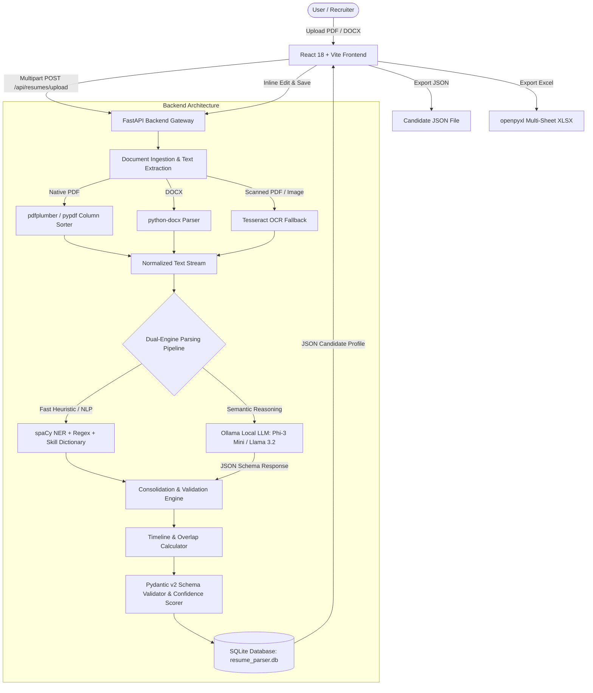

# High-Level Design (HLD.md)

## System: AI-Powered Resume Parser (Standalone Application)
**Document Version:** 1.0.0  
**Target Architecture:** Offline-First, Micro-Monolith (FastAPI + React SPA + SQLite + Local Ollama)  

---

## 1. System Overview

The **AI-Powered Resume Parser** operates as a local client-server web application. A React 18 single-page application (SPA) communicates over standard RESTful HTTP APIs with a Python FastAPI backend. The backend utilizes a **Dual-Engine Extraction Pipeline**:

1. **Deterministic / Heuristic Layer**: High-speed, regex, spatial column layout reconstruction, and spaCy NER extraction for unambiguous facts (emails, phone numbers, URLs, dates, standardized skills, degrees).
2. **Local AI / LLM Reasoning Layer**: Quantized local LLM (Phi-3 Mini or Llama 3.2 via Ollama) to semantically parse ambiguous text, summarize complex project descriptions, and extract non-standard job experiences.
3. **Consolidation & Validation Engine**: Merges deterministic facts with LLM semantic outputs, validates schemas with Pydantic v2, calculates non-overlapping tenures, computes confidence scores, and persists to a local SQLite database.

---

## 2. Key Architectural Components

### 2.1 Presentation Tier (Frontend)
- **Technology**: React 18, Vite, Tailwind CSS, Lucide React icons.
- **Role**:
  - Handles drag-and-drop resume uploading with immediate format & size checks.
  - Displays real-time parsing progress and engine status.
  - Renders an interactive candidate profile with tabbed navigation:
    - Overview & Personal Details.
    - Employment Timeline (interactive cards, editable records, overlap-free duration).
    - Categorized Technical Skills (pill badges with add/remove capability).
    - Education, Projects, Certifications, and Additional details.
  - Highlights missing fields with warning badges.
  - Displays field-level confidence indicators (High / Medium / Low).
  - Provides direct one-click triggers for `.json` and `.xlsx` downloads.

### 2.2 Application Tier (Backend)
- **Technology**: Python 3.12, FastAPI, Uvicorn, Pydantic v2.
- **Sub-modules**:
  - `routers/`: REST endpoints for resume uploading, parsing, candidate retrieval, candidate updates, and exports.
  - `services/text_extraction/`: Extract text while preserving 2-column resume layout without cross-column interleaving.
  - `services/nlp_parser/`: Rule-based extraction (regex patterns, skill taxonomies, date format normalizers, spaCy NER).
  - `services/ollama_client/`: Local HTTP client for Ollama LLM (`/api/generate` with strict JSON format). Graceful fallback if Ollama service is unavailable.
  - `services/merger/`: High-confidence fact merger and overlap-free date calculation.
  - `services/export_service/`: Excel generator using `openpyxl` with styled sheets (Profile, Experience, Skills, Education, Projects).

### 2.3 Data Tier (Persistence)
- **Technology**: SQLite 3, SQLAlchemy 2.0 ORM.
- **Location**: Standalone database file `resume_parser.db` located inside the backend storage folder.
- **Tables**: `resumes`, `candidates`, `personal_info`, `employment_history`, `skills`, `education`, `projects`, `certifications`, `additional_info`.

---

## 3. High-Level Data Flow

1. **Upload**: User drops a `.pdf`, `.docx`, or `.png/.jpg` file into the React UI.
2. **Pre-processing**: The file is stored in `backend/storage/uploads/` with a UUID-based filename.
3. **Text Extraction**:
   - `pdfplumber` analyzes page layout, extracts words, orders text into left and right columns sequentially.
   - If extracted text contains < 50 characters, triggers Tesseract OCR fallback for scanned resumes.
4. **Parsing**:
   - Deterministic Regex extracts emails, phone numbers, GitHub/LinkedIn links, dates, and matches skills against 800+ curated tech terms.
   - If Ollama is active, prompts local LLM with the text and a strict JSON schema. If Ollama is offline, deterministic spaCy/Regex engine completes all sections.
5. **Deduplication & Grounding**:
   - Validates that every extracted fact matches words or patterns present in the original text (strict anti-hallucination).
   - Date ranges are converted to ISO month boundaries and overlapping intervals are merged.
6. **Persistence & Presentation**:
   - Candidate record and related entities are saved to SQLite.
   - Frontend renders the candidate profile with editable inputs and confidence chips.

